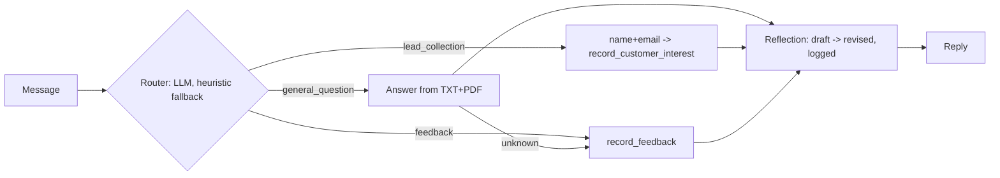

# business_bot - C3 Agent-Powered Business Assistant (CedarWatt Energy)
EECE 503P/798S. Fictional business: CedarWatt Energy (vendor-neutral energy advisory, Beirut).

**Demo video:** https://youtu.be/1t7KTaxu_wI  
**Live demo (Hugging Face):** https://huggingface.co/spaces/afd11/cedarwatt-chat

### Deployed app logs (Hugging Face Space)
Router → tool call → reflection, running live on the Space:


## Run
```bash
pip install -r requirements.txt
cp .env.example .env        # put your free GEMINI_API_KEY (aistudio.google.com) or an OPENAI_API_KEY inside; never commit it
jupyter notebook business_agent.ipynb   # run all cells  (or: python app.py)
```
Colab: upload the folder (`me/`, `.env` or add `OPENAI_API_KEY` to Colab Secrets) and run all cells.

## Files
- `me/about_business.pdf`, `me/business_summary.txt` - business identity (PDF + TXT)
- `business_agent.ipynb` - labelled PERSONA and INSTRUCTIONS blocks, router, 2 MCP-style tools, agent loop with history, reflection bonus, Gradio
- `app.py` - same code as a deployable Gradio app (also used for Hugging Face Spaces)
- `logs/` - leads.jsonl, feedback.jsonl, reflection_log.jsonl (created at runtime)

## Flow

